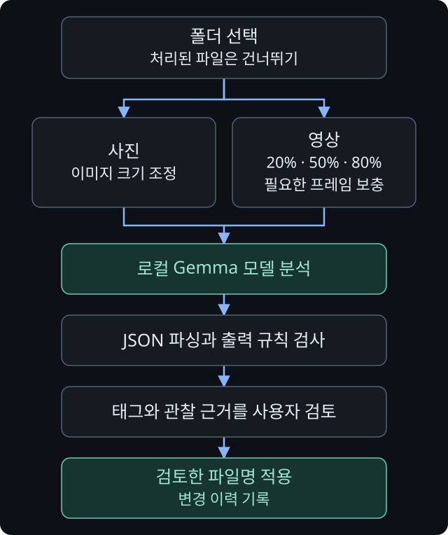

사진과 영상을 많이 찍다 보면 촬영보다 정리가 더 오래 걸린다. 날짜별 폴더를 만들어 두어도, 몇 달 뒤 특정 장면을 찾으려면 파일을 하나씩 열어야 한다. `DJI_20261005104447.MP4`라는 이름만으로는 그 안에 어떤 순간이 담겼는지 알기 어렵다.

AIFFEL DLthon에서 우리 팀 파일구조대는 이 문제부터 다뤘다. 사진과 영상의 내용을 로컬 AI로 분석하고, 검색에 쓸 수 있는 한국어 태그를 파일명에 붙이는 프로그램 **filename**을 만들었다.

이번 프로젝트에서는 모델 선정 이후의 작업이 예상보다 많았다. 같은 모델도 어떤 프레임을 받았는지, 이미지에 얼마만큼의 토큰을 썼는지, 응답을 어떻게 읽었는지에 따라 결과가 달라졌다. 설정 파일의 숫자와 실제 모델 입력을 대조하면서 여러 실험의 해석을 다시 고쳤다.

## 규칙만으로 다루기 어려운 촬영 내용

우리는 규칙 기반 알고리즘만으로 처리하기 어려운 문제 중, AI의 내용 이해 능력을 활용할 수 있는 과제를 찾고자 했다.

촬영 날짜와 확장자를 기준으로 파일을 분류하는 일은 정해진 규칙으로 처리할 수 있다. ‘줄다리기를 하는 장면’이나 ‘파도를 타는 사람’을 찾아 이름에 반영하려면 화면 속 대상과 행동을 이해해야 한다. 이런 해석을 VLM(시각·언어 모델)에 맡기고, 파일명 조합과 변경은 코드로 처리하기로 했다.

사용 흐름은 간단하게 잡았다. 사용자가 폴더를 선택하면 사진·영상을 분석하고, 태그와 관찰 근거를 확인한 뒤 파일명에 적용한다. 실제 Windows 검증에서 사진 한 장의 이름은 다음처럼 바뀌었다.

```text
i01.jpg
→ i01__곤돌라_베네치아_운하_배_관광객.jpg
```

기존 파일명은 남겨 두고, 내용을 설명하는 단어를 뒤에 붙인다. 별도의 검색 서비스를 만들지 않아도 사용자가 파일 탐색기에서 이 단어들을 검색에 활용하도록 하는 것이 목표였다.

## 원본이 있는 PC에서 실행하기

개인 촬영물에는 가족, 지인, 집 안과 일상 공간이 함께 담긴다. 이런 파일을 분석할 때마다 외부 서버로 보내는 방식은 사용자가 받아들이기 어려울 수 있다. 용량이 큰 영상은 업로드 대기 시간도 부담이다. 우리는 원본이 있는 PC에서 분석을 끝내는 구조를 선택했다.

실행 기준은 VRAM(그래픽 메모리) 8GB였다. 사진이나 영상을 취미로 다루고 외장 GPU를 사용하는 사람을 예상 사용자로 잡았고, 그 PC에서 실행 가능한 범위를 직접 확인하고 싶었다. 8GB를 모든 사용자의 평균 사양으로 단정하기보다는 이번 프로젝트에서 충족해야 할 하드웨어 조건으로 두었다.

이 기준은 실험의 방향을 정했다. 품질이 좋아도 메모리를 초과하거나 파일 하나에 너무 오래 걸리면 쓰기 어렵다. 태그의 유용성, 처리 시간, VRAM 사용량을 함께 봐야 했다. 모델과 실행 엔진을 처음 준비할 때는 다운로드가 필요하지만, 준비가 끝난 뒤의 사진·영상 분석은 로컬에서 처리하도록 구성했다.

## 모델을 고른 뒤 효율화에 집중했다

라이선스, 모델 규모, 양자화 파일의 크기, 공개된 이미지·영상 평가를 살펴 후보를 좁혔다. Gemma 4 12B QAT, Qwen3-VL-8B, Qwen2.5-VL-7B, Qwen3.5-9B, GLM-4.6V-Flash를 검토했다. 공개 벤치마크 순위만으로 한국어 촬영 태그의 품질을 판단하기는 어려워, 우리 과업에 맞는 작은 평가를 먼저 진행했다.

초기 평가는 사진 5장과 영상 1편의 연속 프레임으로 구성했다. 사진에는 도시, 스키장, 피크닉, 주방, 캠핑 장면을 넣었고, 영상에서는 자전거 주행 중 행동 변화가 설명에 반영되는지 봤다. 입력마다 핵심 요소를 미리 정해 놓고 태그, 관찰 근거, 출력 형식을 따로 확인했다.

주방 사진의 핵심 요소가 ‘주방·당근·썰기 또는 손질’이라면, ‘재료 손질’도 행동을 제대로 표현한 답으로 인정했다. 태그에 핵심 요소가 들어갔는지와 설명이 장면에 맞는지는 별도로 채점했다.

우리 팀은 이 평가에서 태그와 관찰 근거가 상대적으로 좋았던 Gemma 4 12B QAT를 후속 실험 모델로 선택했다. 로컬 실행에는 Google이 제공하는 Q4_0 GGUF 모델을 사용했다. [공식 모델 카드](https://huggingface.co/google/gemma-4-12B-it-qat-q4_0-gguf)

초기 평가표에는 집계 점수와 개별 점수 합이 다른 항목이 있었고, 후보별 실행 환경도 완전히 통일됐다고 보기 어려웠다. 따라서 이 선택은 우리 과업을 이어 갈 모델을 고르는 판단으로 범위를 한정했다.

처음에는 이미지 이해가 부족하면 LoRA(저랭크 적응) 추가 학습을 검토하고, 출력 형식이 문제라면 프롬프트와 검증 처리를 보완할 계획이었다. 실제로는 추가 학습을 진행하지 않았다. 기본 모델을 활용하면서, **적은 리소스로 쓸 만한 결과를 일관되게 만드는 조건**을 찾는 데 집중했다.

## 평가 기준부터 나눠야 했다

후속 비교에는 사진 20장과 영상 20편을 사용했다. 가로·세로 방향과 해상도가 서로 다른 자료였고, 사람·사물·배경뿐 아니라 영상의 행동 변화도 확인할 수 있도록 구성했다. 원본 크기를 살펴본 뒤 이미지의 짧은 변을 기준으로 입력을 줄여 비교했다. 평가 자료와 정답 기록은 [데이터 저장소](https://github.com/stella1298/filename-rescue)에 정리했다.

모델이 답을 반환했다는 사실만으로는 충분하지 않았다. 실행 완료, JSON 형식 통과, 내용의 정확성은 각각 다른 결과였다.

자동 평가에서는 **출력 태그 중 허용 태그 목록에 포함된 비율**을 계산했다. Precision(정밀도)에 가까운 참고 지표다. 다만 허용 목록에 없는 동의어도 불일치가 되고, 형식 실패나 빈 출력이 평균에서 제외될 수 있어 채점 건수를 함께 확인했다. 초기 모델 선정 때 사람이 의미를 보고 채점한 방식과도 구분했다.

JSON 문법과 필드 규칙의 통과율, 처리 시간, VRAM, 실행 완료율은 별도로 기록했다. 이후에는 원본 장면과 태그를 직접 비교하며 근거 없는 추정, 중복 표현, 검색에 유용한 표현을 표시했다. 엑셀의 빨간 글씨는 감점, 파란 박스는 가점으로 집계했다. 이 사용자 표시 점수는 조건을 비교하는 질적 평가이며 정확도 백분율을 뜻하지 않는다.

모델 선정 평가, 자동 허용 태그 일치율, 사용자 표시 점수를 한 줄의 성능 그래프로 합치지 않도록 주의했다. 서로 다른 질문에 답하는 지표였기 때문이다.

## 8GB 환경에서 실행 범위를 찾다

실험은 품질 점검과 로컬 실행 점검으로 나눠 설계했다. Colab에서는 입력 조건과 품질을 살펴보고, Windows PC에서는 메모리와 처리 시간을 확인했다. 실제 RTX 4060 8GB 실험에서는 해상도, 비전 예산, 영상 프레임 수, 출력 길이, GPU 적재 층수를 바꿔 19개 조건에서 총 640건을 요청했다. 같은 자료를 여러 조건에 반복 사용한 수치다.

640건에서는 실행 오류와 타임아웃이 없었다. 하지만 기준 설정의 원문 JSON 통과는 40건 중 30건이었다. 실행 성공과 프로그램이 곧바로 사용할 수 있는 응답은 구분해서 봐야 했다. [팀의 8GB 실험 기록](https://app.notion.com/p/8gb-3fbae2ab062580c7a2a7ff9c55cb7da0)

GPU 적재 층수도 조절했다. 전체 GPU 적재를 시도했을 때 서버가 종료된 기록이 있어 부분 적재로 비교했다. 당시 종료 원인을 확정할 오류 로그가 없어 OOM(메모리 부족)으로 단정하지는 않았다.

같은 사진 5장과 영상 5편에서 30층을 34층으로 늘리자 사진 처리 시간 중앙값은 11.8초에서 9.6초, 영상은 14.6초에서 11.8초로 줄었다. 장치 전체 VRAM의 표본 최대값은 6,290MiB에서 6,905MiB로 늘었다. 이 조건에서는 메모리를 더 사용해 약 19%의 시간 단축을 얻었다. 34층은 이 비교에서 선택한 값이며, 이후 RTX 3070에서는 38층으로 시험했다.

## 비전 예산을 늘렸는데 입력이 그대로였다

가장 크게 해석을 바꾼 문제는 비전 예산이었다. 로컬 결과가 Colab보다 아쉬워 기록을 비교했는데, 사진 한 장의 이미지 토큰은 Colab에서 약 1,080개, 초기 로컬에서 약 120개로 큰 차이가 났다. 환경과 양자화 방식도 달랐으므로 이 차이 하나를 품질 저하의 유일한 원인으로 볼 수는 없었다. 그래도 실제 입력을 확인할 이유는 충분했다.

코드를 따라가 보니 테스트 프로그램은 요청한 비전 예산을 서버에 전달하면서 Microbatch(마이크로배치)의 기본값을 128로 두고 있었다. 당시 llama.cpp와 모델 조합에서는 이 값이 이미지 토큰 상한에도 영향을 줬다. 비전 예산을 140·280·560·1,120으로 바꿔도 서버에서 같은 상한에 막힐 수 있었던 것이다. [테스트 코드](https://github.com/yooongZa/filename-model-quality-bench/blob/00e5466ff3de67b58d3ec576ed1fc795413a1aff/filename_bench/backends.py#L183-L219)

후속 RTX 3070 서버 로그에는 요청한 이미지 토큰 상한을 마이크로배치 128에 맞춰 낮췄다는 경고가 남아 있었다. 반면 RTX 4060의 당시 로그 원본은 직접 확보하지 못해, 해당 실험은 코드와 팀 회고를 근거로 해석했다. 여기서 약 120은 관측된 이미지 토큰 수이고, 128은 서버가 적용한 상한이다.

마이크로배치를 먼저 256으로 조정해 비전 예산 140이 상한에 막히지 않게 했고, 280·560 비교에서는 배치와 마이크로배치를 576으로 설정했다. 이후 요청값, 서버 로그, 실제 전달 프레임을 함께 확인했다.

이 경험으로 실험 절차도 바뀌었다. 대량 실행에 들어가기 전에 소량의 입력으로 옵션이 실제 적용되는지 먼저 확인해야 했다. ‘해상도나 비전 예산을 늘려도 효과가 없다’는 해석에는 입력이 실제로 달라졌다는 전제가 필요했다.

## 영상 세 장이 같은 장면 한 장으로 줄어든 문제

영상에서는 프레임 추출 방식이 결과를 제한했다. 우리는 영상 길이의 20%·50%·80% 지점에 가까운 Keyframe(키프레임)을 최대 3장 선택했다.

키프레임은 영상 압축과 복호화에 쓰이는 기준 프레임이다. 장면의 의미를 보고 고른 대표 이미지와는 기준이 다르다. FFmpeg의 `-skip_frame nokey`도 키프레임 이외의 프레임을 건너뛰는 옵션이다. [FFmpeg 공식 문서](https://www.ffmpeg.org/ffmpeg-all.html)

실제로 길이 6.63초인 영상에서 목표 시점은 약 1.33초·3.32초·5.30초였지만, 세 목표가 모두 0초의 키프레임에 연결됐다. 중복을 제거하고 나니 모델에는 한 장만 전달됐다. 영상 중간의 행동이 설명에서 빠진 이유를 입력 단계에서 찾았다.

추출 로직을 바꿨다. 목표 시점에 가까운 키프레임이 있으면 사용하되, 키프레임이 없거나 너무 멀거나 같은 프레임이 중복 선택되면 해당 목표 시점의 일반 프레임으로 보충했다. 개선 후 이 영상은 약 1.33초·3.30초·5.30초의 서로 다른 프레임을 전달할 수 있었다.

이 방식도 영상 전체의 의미를 분석해 최적 장면을 고르는 것은 아니다. 세 시점의 정보가 빠지지 않도록 보완한 전처리다. 모델 응답을 평가하기 전에 실제로 전달한 이미지부터 봐야 한다는 점을 배웠다.

## 해상도와 프롬프트를 바꿔 비교한 결과

입력 제한과 프레임 추출을 보완한 뒤에는 네 가지를 확인했다. 비전 예산을 늘렸을 때 품질이 좋아지는지, 해상도를 어디까지 낮춰도 되는지, Thinking(추가 추론) 모드가 도움이 되는지, 관찰과 태그 생성을 두 단계로 나누면 나아지는지였다.

중복 실행을 제외한 비교표에는 13개 조건을 남겼다. 아래는 개선한 프레임 추출 방식을 공통으로 적용한 해상도·비전 예산 네 조건이다. 모두 같은 40개 자료, 단일 프롬프트, 추론 OFF 조건이다.

| 조건 | 짧은 변 | 비전 예산 | 파일당 평균 시간 | 사용자 표시 점수 |
|---|---:|---:|---:|---:|
| R10 | 360px | 280 | 10.01초 | −7 |
| R11 | 720px | 280 | 10.72초 | −3 |
| R12 | 360px | 560 | 9.98초 | −5 |
| R13 | 720px | 560 | 11.06초 | +15 |

720px에서 비전 예산을 280에서 560으로 바꾼 두 조건을 비교하면 평균 시간은 약 0.35초 늘고, 표시 점수는 −3에서 +15로 높아졌다. 이 자료에서는 추가 처리 비용에 비해 태그 평가가 좋아져 R13을 프로그램에 적용할 조건으로 골랐다. 같은 자료를 반복해 설정을 선택했으므로, 새로운 촬영물에서도 같은 결과가 나오는지는 별도 확인이 필요하다.

2단계 프롬프트는 1차에서 대상·행동·배경을 관찰하고, 2차에서 그 관찰 내용만으로 태그를 만드는 방식이었다. 2차는 이미지를 다시 보내지 않는 텍스트 요청으로 구성했다. 태그 최대 4개를 요청하는 버전과 5개를 목표로 하는 버전을 시험했다.

720px·비전 예산 560에서 5태그를 목표로 한 2단계 방식은 평균 24.17초, 표시 점수 +13이었다. 단일 방식의 11.06초, +15와 비교했을 때 이번 평가에서는 두 배 이상 걸리는 비용을 감수할 만큼의 이득을 확인하지 못했다. 이 결과를 보고 기본 동작은 단일 프롬프트로 정했다.

추론 ON도 실행했다. 출력이 끝나기 전에 한도에 닿는 경우를 보며 출력 상한을 단계적으로 늘렸고, 최종 완료한 조건에서는 평균 76.74초가 걸렸다. 40개 중 39개가 정상 결과였고 1개는 검토 대상이었다. 이 과정에서는 문맥과 출력 상한도 함께 바뀌었기 때문에 시간 차이 전체를 추론 모드 하나의 효과로 해석하지 않았다. 폴더 단위 처리를 고려해 채택한 설정은 추론 OFF였다.

## JSON 응답을 실제 파일 작업으로 연결하기

출력 처리에서도 모델 응답과 프로그램 동작 사이에 간격이 있었다. 저장된 40건의 응답을 재평가한 사례에서는 원문을 바로 JSON으로 읽었을 때 23건만 통과했다. 나머지 17건은 JSON 바깥에 코드 블록 표시가 붙어 있었다.

바깥 코드 블록 한 겹을 제거한 뒤 기존 규칙으로 다시 검사하자 40건 모두 통과했다. 이는 같은 응답을 읽는 방법을 보완한 결과다. 태그 내용의 정확성이 올라갔다고 해석하지 않았다. 원문과 정제 후 결과도 따로 남겨 무엇을 바꿨는지 확인하도록 했다.

프로그램에서는 모델이 제안한 `keywords`, `reason`, `place_name`을 읽고 출력 규칙을 검사한다. 유효한 태그는 코드에서 파일명으로 조합하고, 사용자가 검토한 뒤 적용한다. 이름 충돌 시 기존 파일을 덮어쓰지 않고, 변경 전후 이름과 해시를 SQLite 이력에 기록했다. 처리 이력과 태그가 붙은 이름 규칙을 확인해 이미 처리한 파일은 다시 분석하지 않도록 했다.



기본 설정에서는 변경 전 검토를 켜고 자동 변경을 껐다. 장면 해석에는 오류가 생길 수 있으므로, 사용자가 제안된 태그를 확인하고 적용하도록 했다.

## 실험 설정을 프로그램에 적용하고 확인한 범위

선택한 R13의 실행 조건은 다음과 같다. 해상도 720px은 이미지의 짧은 변을 뜻한다.

| 항목 | 적용값 |
|---|---|
| 모델 | Gemma 4 12B IT QAT Q4_0 |
| 입력 해상도 | 짧은 변 720px |
| 비전 토큰 예산 | 560 |
| 영상 입력 | 20%·50%·80% 지점 최대 3장, 필요하면 일반 프레임 보충 |
| 문맥 길이 | 8,192토큰 |
| 출력 토큰 상한 | 5,000토큰 |
| 추론 모드와 프롬프트 | OFF, 단일 프롬프트 |
| GPU 적재 층수 | 38층 |
| 배치와 마이크로배치 | 각각 576 |
| Temperature와 Seed | 0과 42 |
| 동시 요청 | 1개 |

출력 상한 5,000은 앞선 실험에서 이어진 설정이다. 매번 5,000토큰을 생성한다는 의미도, 이 값이 가장 효율적이라고 검증했다는 의미도 아니다. 출력 상한은 별도로 줄여 볼 수 있는 항목으로 남겼다.

R13의 40개 자료 비교에서는 평균 11.06초, 장치 전체 VRAM의 표본 최대값 7,180MiB를 기록했다. 이후 Windows에서 같은 조건의 앱 소스를 실행해 40개 파일을 실제로 분석하고 이름을 변경했다. 분석 시간은 약 455초였고, 파일 내용의 해시가 모두 보존됐다. 같은 폴더를 다시 분석했을 때는 40개를 전부 건너뛰었다. 설치용 실행 파일에서는 별도로 2개 샘플의 분석과 이름 변경을 확인했다.

이 검증으로 모델 출력이 실제 파일 작업까지 연결되는지는 확인했다. 별도 안정화 점검에서는 투명 PNG의 색 처리, 영상의 비정방형 픽셀 비율, 되돌리기와 취소 처리에서 추가 문제가 발견됐다. 이 항목들은 재현 기록을 남기고 후속 수정·검증 대상으로 분리했다. 일부 정상 동작을 확인한 결과만으로 모든 환경의 안정성을 보장하지는 않았다.

## 사용한 기술 스택

실험과 프로그램은 공통 전처리·모델 연결 코드를 재사용했다. 품질 실험과 로컬 실행 조건을 별도 저장소로 나누고, 선택한 조건을 앱으로 옮겼다.

| 영역 | 기술 | 프로젝트에서 맡은 역할 |
|---|---|---|
| 핵심 모델 | Gemma 4 12B QAT, Q4_0 GGUF, mmproj | 사진·영상 프레임의 내용 해석과 한국어 태그 생성 |
| 로컬 추론 | llama.cpp의 llama-server, CUDA | Windows GPU에서 양자화 모델 실행 |
| 초기 모델 비교 | LM Studio | 후보 모델의 응답을 확인하고 평가 |
| Colab 실험 | Python, PyTorch, Transformers, Accelerate | 품질 실험 코드와 모델 실행 환경 |
| 이미지 전처리 | Pillow, NumPy | 이미지 변환과 크기 조정 |
| 영상 전처리 | FFmpeg, ffprobe | 영상 정보 확인과 프레임 추출 |
| 앱 서버 | Python 표준 라이브러리 http.server | 로컬 주소에서 화면과 작업 API 제공 |
| 사용자 화면 | HTML, CSS, JavaScript | 폴더 선택, 진행 상태, 태그 검토와 변경 요청 |
| 출력 검증 | JSON, jsonschema | 응답 파싱과 필드·태그 규칙 검사 |
| 파일 이력 | SQLite, SHA-256 | 변경 전후 기록, 파일 내용 확인, 재처리 제외 |
| 측정과 검증 | psutil, GPU 사용량 기록, unittest, SSH | 자원 측정과 Windows 실기기 검사 |
| 패키징 | PyInstaller | 데스크톱 실행 파일 구성 |
| 협업과 결과 정리 | GitHub, Notion, Excel | 코드 관리, 실험 기록, 태그 비교와 사용자 평가 |

화면은 브라우저에서 열리지만 앱 서버와 모델은 사용자 PC에서 실행한다. 모델은 장면을 해석하고, 파일명 변경과 이력 관리는 일반 코드가 맡도록 역할을 나눴다.

## 다음 프로젝트에서 먼저 확인할 것

이번에 오래 걸린 부분은 모델의 답변을 기다리는 시간만이 아니었다. 환경을 맞추고, 설정이 실제 적용되는지 확인하고, 잘못 해석한 결과를 다시 정리하는 데도 시간이 들었다.

다음에는 대량 실험 전에 대표 사진과 영상 몇 개로 입력 크기, 실제 프레임, 이미지 토큰, 서버 옵션, 응답 원문을 먼저 확인하려고 한다. 그 확인을 통과한 조건만 전체 자료로 확장하면 같은 실수를 줄일 수 있다.

평가용 정답도 더 정리해야 한다. 동의어를 포함한 허용 태그, 근거 없는 추정의 판정 기준, 태그가 부족할 때의 처리 정책을 실험 전에 합의할 필요가 있다. 설정을 고르는 자료와 최종 평가 자료를 분리하고, 여러 사람이 같은 기준으로 평가하는 일도 다음 과제로 남겼다.

filename에서 얻은 결과는 8GB PC에서 돌아가는 실행 조건과 실제 파일명 변경 흐름이다. 그 과정에서 모델 품질, 입력 전처리, 출력 파싱, 파일 작업을 각각 확인하는 습관을 배웠다. 앞으로는 새 촬영물에서도 태그가 유용한지, 사용자가 검토하고 되돌리는 과정이 충분히 안전한지를 더 살펴보려 한다.

코드는 [filename](https://github.com/yooongZa/filename), [모델 품질 실험](https://github.com/yooongZa/filename-model-quality-bench), [로컬 실행 성능 실험](https://github.com/yooongZa/filename-local-capacity-bench) 저장소에 나눠 두었다. 실험 결과와 시연은 [발표 자료](https://filename-dlthon-20261019.pages.dev/), 협업 과정의 회고는 [팀 KPT](https://app.notion.com/p/kpt-3feae2ab062580dd9400eb6d705240f6)에 정리했다.

## 관련 글과 내려받기

- [본문 Markdown](/blog/ai-study/32-filename-local-ai/article.md)
- [처리 흐름 구성도 SVG](/blog/ai-study/32-filename-local-ai/pipeline.svg)
- [이전 글: 31. 모델 고르기: 메모리, 라이선스, 비용의 기준](/blog/ai-study/31-model-selection/)
- [전체 글 목록](/blog/)
